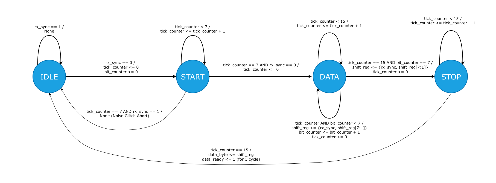

# FPGA MIDI Visualiser

A real-time MIDI-to-LED visualizer built for the Xilinx Arty A7. It reads a standard 31,250 baud MIDI data stream and maps specific keyboard pitches to the board's LEDs.

## Hardware Requirements
- **Target Board:** Arty A7 (100MHz System Clock)
- **MIDI Interface:** MIDI-to-TTL Breakout Board. Standard MIDI cables use current loops that will damage FPGA pins if connected directly. The breakout board uses an optocoupler to safely convert these loops into 3.3V digital logic.

## Repository Structure
```text
├── assets
│   └── uart_rx_fsm_diagram.png      # State machine diagrams
├── constraints
│   └── arty_a7.xdc          # Physical pin mappings
├── sim
│   └── run_sim.sh           # Testbench execution script
├── src
│   ├── midi_parser.sv       # FSM to extract Note On messages and pitch
│   ├── note_led_mapper.sv   # [WIP] Combinational logic mapping pitch to LEDs
│   ├── top.sv               # [WIP] Top-level wrapper
│   └── uart_rx.sv           # Custom asynchronous serial receiver (8-N-1)
├── tb
│   ├── tb_midi_parser.sv    # Verification for MIDI protocol state machine
│   ├── tb_top.sv            # [WIP] System-level verification
│   └── tb_uart_rx.sv        # Verification for serial timing and synchronisation
├── .gitignore               
├── LICENSE                  
└── README.md                
```

## System Architecture

### 1. Serial Receiver (`src/uart_rx.sv`)
Captures the raw input from the MIDI-to-TTL board. 
- **Synchronisation:** Uses a 2-flop synchroniser (`rx_meta`, `rx_sync`) to safely cross the asynchronous external signal into the 100MHz clock domain.
- **Oversampling & Extraction:** Divides the 100MHz clock to generate a 16x oversampling tick for the 31,250 baud rate, packaging the serial bits into standard 8-bit bytes.



### 2. Protocol Parser (`src/midi_parser.sv`)
Filters the data stream for standard 3-byte MIDI "Note On" messages (Status, Pitch, Velocity). The FSM uses three states (`IDLE`, `WAIT_NOTE`, `WAIT_VELOCITY`) to ignore irrelevant commands like pitch bends, trap the pitch byte, and generate a single-cycle `note_valid` pulse for the downstream mapper.

### 3. LED Mapper (`src/note_led_mapper.sv`) - *[WIP]*
*(To be completed: Combinational logic case statements translating specific hex note values into active-high signals for the onboard green and blue LEDs).*

### 4. Top-Level Wrapper (`src/top.sv`) - *[WIP]*
*(To be completed: Wiring internal buses between the receiver, parser, and mapper, and routing the external clock and reset).*

## Verification 
Simulation uses SystemVerilog testbenches in the `/tb` directory.

- `tb_uart_rx.sv`: Tests the synchroniser against simulated noise glitches, verifies baud rate timing drift, and runs back-to-back transmission stress tests.
- `tb_midi_parser.sv`: Injects mock UART bytes to verify the FSM isolates "Note On" sequences, ignores bad status bytes, and recovers from resets mid-transmission.
- `tb_top.sv`: *[WIP system-level integration tests]*.

## Build and Run
*(To be completed: Command-line steps to run `sim/run_sim.sh` and instructions for synthesising the bitstream using Vivado with `constraints/arty_a7.xdc`).*
